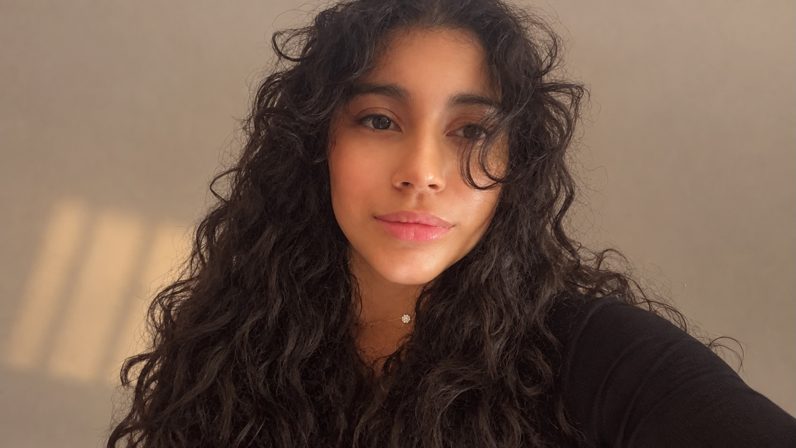

# Skyla Valle

### Aspiring Ocean Data Analyst

Welcome to my professional portfolio!

I am a computer science student interested in programming, data analysis, and using technology to support ocean conservation and marine research.

## About Me
## About Me

Hello! My name is Skyla Valle, and I am a student pursuing a degree in Computer and Information Sciences, with an expected graduation date of Fall 2027. I have developed an interest in technology, programming, and discovering how computer science can be used to solve real-world problems. Throughout my education, I have been building my technical knowledge and gaining hands-on experience through different programming projects.

My technical interests include software development, artificial intelligence, data analysis, and data visualization. I enjoy learning how applications work, solving programming challenges, and finding ways to use technology to make information easier to understand. Through my coursework and personal projects, I have gained experience with Python, C++, data analysis tools, and AI technologies.

One of my projects, StudyBuddy AI, allowed me to explore artificial intelligence by developing an interactive study application. I also developed a Simple Cache Simulator using C++ and an Ocean Data Explorer using Python, Pandas, and Matplotlib. These projects have helped me strengthen my programming, problem-solving, and technical skills while giving me opportunities to apply what I have learned.

Beyond computer science, I have a strong interest in the ocean, marine animals, and environmental conservation. My long-term career goal is to become an ocean data analyst. I would like to combine my knowledge of computer science with my interest in marine environments by working with oceanographic and environmental data. I hope to contribute to research that helps people better understand ocean conditions, protect marine ecosystems, and support the conservation of marine animals.

As I continue my education, I plan to strengthen my skills in programming, statistics, data analysis, and scientific data visualization. I also hope to gain more experience with technologies used in environmental and marine research.

Ultimately, I want to build a career where I can combine my passion for technology with my interest in protecting the ocean. I believe that continuing to learn, developing new skills, and gaining practical experience will help me work toward that goal.
